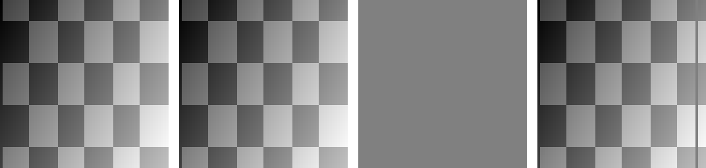

# Sending pictures with sound

This project sends a small picture from one device to another using nothing
but a speaker and a microphone. The picture is turned into a 23-second burst
of audible tones, played out loud, recorded on the other side and turned back
into the picture.

Under the hood it is the same idea Wi-Fi and 4G use (OFDM), just slowed down
to audio frequencies. Everything is written in plain MATLAB, with no toolboxes.


## Results so far

| Test | Packets received | Notes |
|---|---|---|
| One MacBook, its own speaker into its own mic | **64 / 64** | No errors at all, about 2 kbit/s |
| Phone speaker into MacBook mic, no error correction | 0 / 64 | About 1 bit in 80 arrives wrong, and one wrong bit spoils a packet |
| Phone speaker into MacBook mic, **with error correction** | **63 / 64** | The code fixed around 19 bad bits per packet, about 1.4 kbit/s |
| Windows laptop into MacBook | 0 / 64 | The laptop's built-in audio "enhancements" distort the signal |



*Left to right: the picture we sent, what one MacBook received from itself,
what arrived from a phone without error correction (nothing, so it stays
gray), and what arrived with error correction. The thin gray line on the
right is the one packet that did not make it.*

Each picture is split into 64 packets of 64 bytes. Every packet carries a
checksum, so the receiver either gets a packet exactly right or throws it
away and leaves that strip gray. Nothing is ever shown wrong.

## How it works

1. **Packets.** The picture (4096 bytes) is cut into 64 packets of 64 bytes,
   each with a number saying which one it is.
2. **CRC32.** Every packet gets a 32-bit fingerprint. The receiver recomputes
   it: if it matches, the packet is kept; if not, it is dropped and that
   column of the picture stays gray.
3. **Error correction.** A convolutional encoder sends two coded bits for
   every data bit, and a Viterbi decoder on the other side finds the most
   likely original, fixing a few wrong bits per packet.
4. **OFDM.** The bits are played as 128 tones at once between 2 and 8 kHz,
   two bits per tone (QPSK). A short copy at the start of each chord soaks up
   echoes. The receiver finds each packet by its opening chirp, learns the
   room from two known training chords, and uses pilot tones to stay in time.

## Getting started

You need MATLAB R2020a or newer. It has been run on R2024a (macOS) and R2026a
(Windows). Open MATLAB in this folder and run the tests:

```matlab
run_tests
```

All 11 tests should pass in under a minute. Nothing plays sound.

## Try it on one laptop

This plays the picture through your laptop speaker and records it with the
laptop's own microphone. Turn the volume to about 50% first.

```matlab
run_speaker_demo('check')                             % 1 second, quick sanity check
run_speaker_demo('image', 'fec', 'picture', 'smiley') % the whole picture, ~23 s
```

When it finishes it prints how many packets arrived and saves a summary
figure in `figures/` showing the sent and received picture side by side.

## Try it with two devices

One device plays a sound file, the other records and decodes. A phone
works well as the sender. A MacBook works well as the receiver.

1. **Get the sound file onto the sender.** Every picture already has one in
   [`transmit/`](transmit/), for example `transmit/smiley_fec.wav`. AirDrop it
   to an iPhone, or open it from GitHub on an Android phone. Do not send it
   through WhatsApp or iMessage as a voice note, as they compress the audio.
2. **Start listening on the Mac**, in MATLAB:
   ```matlab
   run_speaker_demo('listen', 'fec', 'picture', 'smiley')
   ```
3. **When it says `RECORDING`, press play on the phone.** You have about
   25 seconds to start it, and exact timing does not matter. Hold the phone's
   speaker 5 to 10 cm from the Mac's microphone (top left of the keyboard on
   most MacBooks), with the volume around 60%.
4. Keep quiet and still for about 25 seconds. The Mac then decodes the
   recording and shows you the picture it received.

If you would rather record with another app (QuickTime, a phone voice
recorder), decode the file afterwards with
`run_speaker_demo('file', 'my_recording.m4a', 'fec', 'picture', 'smiley')`.

## Pictures

The built-in pictures are `checkerboard`, `smiley`, `heart`, `ofdm` and
`landscape`. They are all 64 by 64 pixels in grayscale, drawn by
`pictures.makeLibrary` in [pictures.m](pictures.m).

To send your own, drop any PNG into `images/`, then make its sound file:

```matlab
run_speaker_demo('prepare', 'fec', 'picture', 'my_cat')   % writes transmit/my_cat_fec.wav
```

It is shrunk to 64 by 64 and turned gray, so simple, high-contrast pictures
work best.

## Why error correction matters

Without error correction a packet is either perfect or lost. Between two
devices the sound gets a little distorted on the way, and roughly one bit in a
hundred comes out wrong. With 576 bits per packet, practically every packet
then has at least one mistake, and the checksum rejects it.

Adding `'fec'` sends every bit twice in a clever, interleaved way (a
convolutional code, the same family Wi-Fi uses). The receiver can then work
out the original even when a few percent of the bits are wrong, and it gives
less weight to bits that arrived on weak frequencies. The cost is a slower
transfer: 23 seconds per picture instead of 16.

The sender and receiver must agree: use `'fec'` on both or on neither.

## When it does not work

- **Very few packets found.** The recording missed the start, or the sound
  is too quiet. Start recording first and move the devices closer.
- **Packets found but none pass.** Usually distortion. Lower the sender's
  volume a little, move closer, and turn off any audio effects (on Windows:
  Sound settings, your speaker, Audio enhancements off).
- **The recording is silent.** Give MATLAB (or your terminal) microphone
  access in System Settings, Privacy & Security, Microphone.
- **Larger distances.** We have only tested at close range. Echoes longer
  than about 5 ms (big, bare rooms) break the link.

Each run saves the raw recording, the decoded picture and a diagnostics
figure, so you can always go back and look at what happened.

## The code

| File | What it does |
|---|---|
| [packets.m](packets.m) | Bytes to bits, CRC32 checksum, add and check it |
| [fec.m](fec.m) | Convolutional encoder, Viterbi decoder, bit shuffling |
| [ofdm.m](ofdm.m) | QPSK, the 128-tone chord, chirp, training chord, pilot timing fix |
| [transmitter.m](transmitter.m) | Picture to packets to sound |
| [receiver.m](receiver.m) | Sound to packets to picture |
| [pictures.m](pictures.m) | The built-in pictures |
| [run_speaker_demo.m](run_speaker_demo.m) | The demo: play, listen, decode, save results |
| [run_tests.m](run_tests.m) | 11 quick checks |
| [trace_one_packet.m](trace_one_packet.m) | Follows one packet through every step |
| [config.m](config.m) | All settings |

Folders hold data only: `images/` (pictures), `transmit/` (sound files to
play), `data/` and `figures/` (results of real runs), `docs/` (PDFs).

## Limits and next steps

- Pictures are small (64 by 64, grayscale), and the data rate is modest.
- Only short distances work reliably. Echoes longer than about 5 ms are the
  main obstacle in bigger rooms.
- Many laptops apply audio processing you cannot fully switch off, and that
  hurts more than background noise does.
- The receiver needs to know which picture size to expect. There is no
  general file transfer yet.

Ideas we have not tried yet: adapting how many bits each frequency carries to
the room, a longer guard time for echoey rooms, and colour pictures.

## More detail

- [docs/theory.pdf](docs/theory.pdf): how it works, in plain words
  (LaTeX source in `docs/theory.tex`).
- [docs/presentation_script.pdf](docs/presentation_script.pdf): talk script,
  demo steps and likely questions.
- [docs/two_device_guide.pdf](docs/two_device_guide.pdf): a printable
  two-page version of the two-device instructions.
